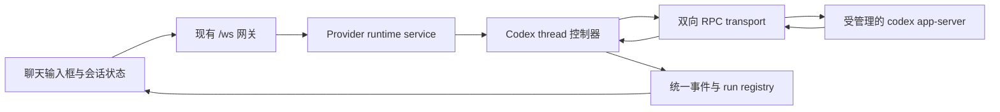

Codex app-server 接入实施记录与计划

已按确认的交互完成实现：Codex 默认通过仓库固定版本 0.163.0 的 app-server 执行；运行中发送仍默认排队，通过排队卡片上的“↳ 引导”追加到当前 turn。原生 Plan、结构化提问、持久化 Goal、经原生终态确认的停止已接入。停止后保留会话和排队内容。下文保留此前设计阶段的版本记录，Composer Predictions 的当前实现见文末。

实施日期：2026-10-13；调研及改动基线：`7c3049fe`。以下先记录交付行为与验证范围，再保留此前确认的设计及验收目标。

**当前实现与使用**

- 输入框上方提供 Plan/执行模式切换；`/plan` 仅切换模式，`/plan <任务>` 使用原生协作模式执行。运行中的 Plan 任务保持排队。选择“执行计划”会切回执行模式并填入实施提示词，用户发送后开始执行。
- 账号额度默认关闭。仅设置服务端环境变量 `CLOUDCLI_CODEX_RATE_LIMITS_ENABLED=true` 后，设置→Agents→Codex→账号中显示额度卡片；修改后重启后端并刷新浏览器。卡片显示周额度剩余百分比，Codex 报告 5 小时额度时一并显示。打开卡片只读取内存缓存，不启动 app-server；点击刷新才发送一次 `account/rateLimits/read`（进程未运行时按需启动，并发刷新合并为一次）。普通 app-server 使用期间的 `account/rateLimits/updated` 会持续填充缓存，退出后保留旧值并标记过期，`account/updated` 清空缓存防止跨账号串号。该功能不轮询、不保活，也不改变空闲退出机制。
- Goal 默认关闭。仅设置服务端环境变量 `CLOUDCLI_CODEX_GOAL_ENABLED=true` 后开启；修改后重启后端并刷新浏览器，无需为切换开关重新构建前端。后端 capabilities 决定目标面板、`/goal` 提示及请求入口；服务端同时拒绝关闭状态下的目标创建/继续，并将开关传给原生进程的 `features.goals`，包含 SDK 兼容运行器。Plan、steer 和普通聊天独立于此开关。
- 开启后，`/goal` 打开目标编辑器；`/goal <目标>`、`/goal pause|resume|clear` 和面板控件共用服务。展示全部六种原生状态、累计 token 和时间。预算仅在明确填写时设置；耗尽后不自动清零或提高。Plan 中创建的 Goal 保存为 paused。
- 排队卡片保留删除及更多菜单中的编辑操作；只有活跃且可引导的 turn 显示可用的“引导”。服务端原子占用消息，accepted 才消费；拒绝保留，结果未知挂起，重连读取原生历史核对。无法证明是否接收时，停止任务后可明确选择重新排队或丢弃。
- Stop 暂停目标、挂起队列、等待 turn 真实终态，并清理本线程的后台终端和已知所属子线程。超过确认期限显示“停止未确认”，支持重试；不会将 interrupt RPC 的空响应当成停止成功。定时抢占发送也必须先得到停止确认。
- Goal 自动 turn 建立新的 executionId 和 writer，订阅、流式消息及重连回放沿用现有 WebSocket。普通队列在 Goal 活跃及停止挂起时不派发。停止前已排队的旧控制动作不能在停止完成后重新激活目标。
- 保留 SDK 显式兼容选项，在聊天区 Codex 详情中切换；SDK 模式不提供原生控制。`CLOUDCLI_CODEX_RUNTIME_MODE=sdk` 可设置尚未持久化选择的会话默认值。详情同时展示运行状态、启动进程 PID、按浏览器本地时区显示的启动时间、实际 bundled launcher 路径及 CLI 版本，并提供空闲重启。
- 沿用 JSONL 历史、搜索与现有 turn 级编辑/分叉。原生 userMessage 的 client_id 在历史加载中保留，实时文件工具与历史共享工具 ID，减少刷新重复。fork 使用同一条受管理连接。

应用控制统一使用 `chat.control` + `control.action` 的类型化联合，而不是分别新增多个消息名；独立 `control_result` 携带 requestId 和状态。原有 `chat.send`、`chat.abort`、`chat.subscribe` 保持兼容。runtime 设置放在会话的 Codex 详情中，确保运行时与会话绑定。所有数据迁移随现有数据库初始化执行；没有新增服务端端口。

**审查修复（2026-10-13）**

- Goal 关闭时仍在首次进入会话及断线重连后核对 steer 历史回执；沿用现有恢复入口，服务端跳过原生 Goal RPC，不再让已送达消息长期停留在未知状态。新增前端两种恢复场景及后端历史确认回归测试。
- 项目安装脚本白名单保留 bcrypt、better-sqlite3、node-pty 的既有许可，同时允许固定版本的 @vscode/ripgrep，避免 npm 用项目白名单覆盖本地许可后阻止原生依赖安装。
- 为便于持续合并 main，Codex 控制校验、排队占用与回执处理集中在 WebSocket 模块的 `codex-chat-control.service.ts`，通用入口只委派和返回结果。调度器通过可选的 `isQueueBlocked` 运行器契约判断是否等待；Codex 的 Goal、停止阶段和持久化 hold 由 Codex 运行器解释。
- 新建表沿用 `schema.ts`，旧草稿补列和重启恢复集中在具名迁移函数，初始化入口只增加调用。非 app-server 的排队卡片保留直接编辑按钮；Codex 保留引导及更多菜单。草稿顺序、账号隔离、消息标识和停止确认修复继续保留。

- Goal 设置与恢复共用普通发送的 sandbox/approval 映射，激活前同步当前权限，避免沿用上一轮的完整访问权限。
- 普通发送记录 Stop 代次，在 thread 初始化和模型解析后核对；已经取消的提交不再启动 turn，之后的明确新提交仍可正常运行。
- 退出登录使等待中的草稿保存、删除和历史读取失效；新账号使用独立写入队列，旧请求完成不会解除新账号的保存保护。
- SDK 切换先释放所属执行与原生线程，收到 `thread/closed` 后才提交选择；切回原生时重新恢复历史及持久化 Goal。切换期间拒绝并发发送与修改，失败保留原选择，最终状态广播给订阅者。
- 子线程的请求结束、turn 结束及线程关闭通知只清理该子线程的问题和审批，不结束父线程；新 turn 清除上一轮错误提示。

受管理的私有 app-server 使用 `thread_unload_delay_secs=0`，让取消订阅后的空闲线程立即开始卸载；仍等待关闭通知而不是仅信任 unsubscribe ACK。固定版本的延迟卸载语义见[原生生命周期实现](https://github.com/openai/codex/blob/rust-v0.156.1/codex-rs/app-server/src/request_processors/thread_lifecycle.rs)。新增真实二进制测试经过 app-server → SDK → app-server 三轮，检查 SDK 新增回答确实进入下一轮模型输入；两个执行器均使用独立 CODEX_HOME 和本地模拟模型。

**验证记录**

2026-10-13 最终审查修复验证：后端专项 65 项、前端专项 25 项通过；新增首次加载/重连回执恢复测试在修复前失败、修复后通过。前端全量 110 个文件、756 项通过，构建、类型检查、lint 和差异检查通过。npm 策略检查确认四个依赖的脚本均被允许；通过正常 `npm rebuild @vscode/ripgrep` 成功补装二进制，搜索测试恢复通过。后端全量 671 项，668 通过、1 跳过、2 失败；仅剩两个原生 smoke 在启动时被 `codex-proxy` 以 `invalid app-server sandbox configuration` 拒绝，未修改测试以掩盖此环境限制。

2026-10-13 合并维护整理验证：后端 runtime/dispatcher/WebSocket/迁移专项 56 项通过，覆盖旧草稿升级、重复迁移、重启后的未知回执保留及无效控制请求隔离；前端 110 个文件、754 项通过；构建、类型检查、lint 和差异检查通过。完整 `npm test` 为 670 项，666 通过、1 跳过、3 失败：两项原生 smoke 仍被宿主 sandbox 配置拒绝，一项既有搜索测试因 `@vscode/ripgrep` 缺少二进制而失败，单独复跑确认同一原因。尝试重新构建该依赖时，安装脚本被环境的 `allowScripts` 策略阻止；未更改此策略或将失败测试标记为通过。

2026-10-13 后续 Goal env 开关验证：前端 110 个文件、754 项通过；后端 capability/runtime/transport/WebSocket 专项 41 项通过；构建、类型检查、lint 通过。包含默认关闭、仅 `true` 开启、隐藏面板和 slash 提示、手输 `/goal` 拦截、服务端激活拒绝、普通 Plan/steer 可用，以及进程启动参数覆盖。当前宿主的 `codex-proxy` 以 `invalid app-server sandbox configuration` 拒绝 app-server 启动，两个既有真实进程 smoke 未能执行到功能验证；下方真实 smoke 通过记录属于此前环境，不能视作本次开关的真实进程验证。

验证使用安装后的仓库依赖；没有调用 PATH 中另一个版本的 Codex，也没有使用真实账号进行付费推理。

| 层次 | 已验证内容 |
| --- | --- |
| 原生 0.156.1 smoke | 独立 CODEX_HOME、临时项目及 localhost 模型响应；实际执行固定 Node 等待命令，steer 保持 turnId，停止后确认该进程消失；thread fork 写入独立文件；Plan 可用；Goal paused→active 自动启动、blocked→paused 持久化；client_id 写入 JSONL；SDK 往返切换后上下文完整 |
| runtime 与 transport | 半包/粘包、并行 RPC、字符串反向请求 ID、超时/EPIPE；Plan 与权限分离；Goal 激活同步权限；问题应答与子代理请求清理；逐 item 更新；Goal 自动多轮 writer；等待真实停止、停止重试、thread 初始化及模型解析期间停止、晚到自动 turn、所属子任务隔离、进程崩溃、并发 Goal 激活与 Stop；运行器切换排他、卸载失败恢复及成功重试清除错误 |
| 队列与 WebSocket | steer/自动派发的原子竞争、重复请求、旧 PUT 防复活、已接收消息不被晚到超时覆盖、未知结果恢复、停止失败禁止抢占发送、旧 executionId 停止请求不影响新任务 |
| 前端 | 默认排队、引导处理中/未知状态禁用、SDK/Plan 限制、Plan 执行入口、结构化提问、slash 优先级、队列 ID/模式持久化、Goal 间隙忙碌状态、executionId 回放、item 更新、连续草稿保存与恢复；退出登录取消旧账号读写且不阻塞新账号 |

最终执行记录：

- `npm test`：662 项，661 通过、1 跳过、0 失败。跳过的是缺少指定真实历史 fixture 的既有测试；两个原生 smoke 均通过。首次与构建、前端测试同时执行时，既有 Claude 测试的固定 25ms 等待触发一次失败；单独及完整后端复跑通过。
- `npm run test:client`：107 个文件、742 项通过。
- `npm run build`、`npm run typecheck`、`npm run lint`：通过。lint 保留仓库既有警告，Vite 保留大 chunk 提示。
- `git diff --check`：通过。

验证边界：真实二进制 smoke 使用本地确定性模型响应，未验证生产模型的规划质量、长期自主执行效果或真实外部 MCP 工具。当前宿主无法运行 macOS sandbox-exec 子进程，因此固定测试命令使用测试会话的 bypassPermissions；应用默认权限策略未放宽。Windows 的原生进程终止 smoke 尚未执行，测试明确标注跳过；子线程停止由协议竞态测试覆盖。没有把这些结果描述为跨平台或真实模型端到端验收。

**此前确认的设计与验收目标**

**调研结论与参考范围**

| 对象 | 已核对的现状 | 对计划的影响 |
| --- | --- | --- |
| `codex-runtime.provider.ts` | 对话使用 `@openai/codex-sdk`，每次调用 `runStreamed`；停止使用 `AbortController` | 保留为显式兼容选项，增加 app-server runtime |
| `codex-app-server.client.ts` | 为 fork 临时启动 app-server，仅处理 RPC 响应 | 复用其 fork 对外能力，底层改为受管理的持久进程和双向协议 |
| `IProviderRuntime` / `provider-runtime.service.ts` | 主要提供 run、abort 和权限桥接 | 增加可选运行控制与能力查询契约 |
| `chat-websocket.service.ts` | 活跃会话拒绝再次 `chat.send`；abort 后合成 complete | steer 必须单独路由；停止必须等待真实结果 |
| `chat-run-registry.service.ts` | 每个会话只允许一个活跃 run，complete 结束 run | 保留单 turn 排他；另设长期 thread 控制器承接 Goal 自动续轮 |
| `useChatComposerState.ts` | 忙碌时先进入排队分支，之后才解析 slash 命令 | 控制命令必须先解析，否则 `/goal pause` 会排队等待 |
| `useChatRealtimeHandlers.ts` | 多数 `protocol_error` 会使会话进入 idle；流式文本使用单个累积缓冲 | steer/stop 失败不能结束原运行；新流事件按会话、turn、item 隔离 |
| `scheduled-message-dispatcher.service.ts` | 会话空闲后自动派发排队消息；定时消息可先中断运行 | 增加停止期间的派发保护，以及 Goal 与本地队列的调度边界 |
| Codex 历史与分叉 | JSONL 读取已有同 turn 多条 user prompt 支持；仅第一条可作为编辑锚点 | steer 后必须保持现有 turn 级编辑/分叉语义 |

[上游 PR #1262](https://github.com/siteboon/claudecodeui/pull/1262) 调研时仍为 open draft，参考提交为 [`7a50a268c8dec6431ff5ed728e55cdc8f00ff280`](https://github.com/siteboon/claudecodeui/pull/1262/files/7a50a268c8dec6431ff5ed728e55cdc8f00ff280)。它适合参考 transport、进程管理、runtime 选择、权限桥接和 lazy start 的组织方式。按本仓库模块标准适配相关实现，不整体合并其 53 个文件。

PR 的主要缺口是没有 steer、Plan 和 Goal；runtime 的 abort 使用异步触发 interrupt 后立即返回，网关仍会提前 complete；事件路由绑定单个 run，不能直接承接 Goal 后续自动 turn；用户提问请求也尚未桥接。其历史读取切换属于额外范围，本方案第一期保留本仓库 JSONL 历史与索引。

官方说明确认了 steer、interrupt 和持久化 Goal 的协议入口；Plan 通过 collaborationMode 设置。[app-server 文档](https://learn.chatgpt.com/docs/app-server)；Goal 的跨 turn 继续、暂停及预算语义见 [Using Goals in Codex](https://developers.openai.com/cookbook/examples/codex/using_goals_in_codex)。

本仓库固定 `@openai/codex` 为 **0.156.1**，本机 PATH 命令为 0.162.1。计划阶段从 npm 获取 0.156.1 对应平台包并验证完整性，在临时目录导出 stable / experimental 协议。实施阶段已安装仓库依赖并补充上文所列原生 smoke。协议结果如下：

| 能力 | 0.156.1 实际导出结果 | 实施约束 |
| --- | --- | --- |
| steer | `turn/steer`，必需 `expectedTurnId`，可传 `clientUserMessageId` | 绑定目标 turn；消息 ID 用于关联，不据此假定服务端支持幂等重试 |
| 停止 | `turn/interrupt` | RPC 接受与 turn 真正结束分别处理 |
| Plan | `turn/start.collaborationMode`、`collaborationMode/list` 在 experimental 导出中 | 初始化显式启用 `experimentalApi`；按固定版本的字段发送 |
| 用户提问 | `item/tool/requestUserInput`，含 `questions`、`isBlocking`、`autoResolutionMs` | 支持阻塞与非阻塞问题，不能统一当成权限审批 |
| Goal | `thread/goal/set|get|clear` 及 updated/cleared 通知 | 使用 app-server 原生持久化状态 |
| Goal 状态 | active、paused、blocked、usageLimited、budgetLimited、complete | UI 完整展示状态，不能只实现 active/complete |
| Goal 设置字段 | threadId、objective、status、tokenBudget | 0.156.1 没有 0.162.1 的 origin 字段，不能混用版本契约 |

以上为协议基线。实施中已确认 goal/set(active) 会原生自动启动，无需另发 turn/start；停止命令进程的实际收敛已验证，子任务和模型行为的验证边界见上文。

**交互约定**

| 用户动作 | 拟定行为 |
| --- | --- |
| 空闲时发送 | 创建或恢复 thread，执行 `turn/start` |
| 执行中发送普通提示词 | 默认进入现有持久队列，在输入框上方显示排队消息卡片 |
| 点击排队卡片上的“引导” | 将该条排队消息立即作为 steer 追加到当前 turn；成功后移出队列 |
| 保持排队，不点击“引导” | 普通任务结束后自动发送；Goal 活跃时等待该 Goal 执行结束；用户主动暂停则进入 hold |
| `/plan` | 进入 Plan 协作模式，不发送空消息；输入框显示当前模式 |
| `/plan <任务>` | 进入 Plan 并提交任务；运行中先保留任务，待当前 turn 结束后按 Plan 启动，不以 steer 修改当前 turn 模式 |
| 选择“执行计划”或切回普通模式 | 明确切回 default，用户确认发送后开始执行；计划生成结束不自动实施 |
| `/goal` | 查看当前 Goal；无 Goal 时显示创建入口，不自动创建 |
| `/goal <目标>` | 设置目标并启动原生 Goal 工作；已有 Goal 时按明确的替换操作更新目标，界面反映用量重置 |
| `/goal pause` | 暂停目标，若当前有 turn 则中断；完成后保留目标与进度 |
| `/goal resume` | 恢复可继续的目标；受预算或用量限制时展示原因，不绕过限制 |
| `/goal clear` | 先停止相关执行，再清除目标；保留对话历史 |
| 点击停止 | 暂停 Goal、挂起当前排队消息、中断当前 turn；显示“正在停止”，确认后才显示结束 |

根据用户提供的界面截图，采用“默认排队 + 排队卡片上的引导按钮”，替代此前“默认 steer”的建议。复用现有 `QueuedMessageCard.tsx`，第一期沿用现有单条排队消息的容量及编辑行为，不扩展成多消息队列。

排队卡片位于输入框上方，左侧显示消息摘要与附件，右侧依次提供“↳ 引导”、删除图标和更多菜单；编辑操作放入更多菜单。普通发送按钮在运行中表达“排队发送”，steer 入口使用“引导”文案，说明为“立即追加到当前任务”。保持仓库现有视觉风格，移动端也保留可见的“引导”文字与足够的点击区域。

| 卡片状态 | 界面反馈与操作 |
| --- | --- |
| 排队中，当前有可 steer 的 turn | “引导”可点击；不操作则按原规则等待自动发送 |
| 引导请求处理中 | 按钮显示进度及“引导中”；卡片保留，暂时禁用重复引导、编辑和删除 |
| 引导已接受 | 移除对应排队项，在对话中确认该用户消息；沿用同一个 turn |
| 引导被拒绝 | 保留卡片及错误说明，提供重试或恢复排队；当前 turn 已结束时可选择作为下一条发送 |
| 引导结果未知，例如断线或超时 | 显示“正在确认”；挂起该消息的自动发送，重连对账后再决定下一步 |
| 当前正在停止、尚未获得 turnId 或没有活跃 turn | 引导不可用，提示具体原因；保留消息 |
| 当前 runtime 不支持 steer | 不显示引导操作，继续使用原有排队、编辑与删除 |

“引导”发送的是卡片中已排队的消息及其附件，不读取用户此时正在输入的新草稿。控制命令仍在入队前解析，`/goal pause` 等操作不生成普通排队卡片。

Plan、权限设置和 Goal 分别建模。Plan 是 `default | plan` 的协作模式；sandbox/approval 决定工具权限；Goal 是 thread 上的持久目标。进入 Plan 不改变原有权限选择，也不把 `permissionMode: plan` 当作 Codex 原生 Plan。进入 Plan 时先暂停活跃 Goal；Plan 中创建目标可先保存为 paused，用户选择执行后再激活，避免自动进入开发。

**后端架构与状态约束**

app-server 在第一次相关操作时启动。初期按当前后端 Codex 凭据作用域共享一个受管理进程，通过 threadId 隔离多个会话；不以 cwd 为理由反复启动进程。固定使用项目依赖的 CLI，诊断中展示实际路径和版本；不静默借用 PATH 的不同版本。若以后支持多套 Codex 凭据，再按凭据作用域隔离进程。

transport 处理按行 JSON、半包/粘包、请求响应、通知和服务端反向请求；支持字符串/数字 RPC ID、超时、写入背压、EPIPE、进程退出与统一待处理请求清理。stdio wire 格式以固定版本导出及文档为准。初始化使用 CloudCLI 自己的 clientInfo，等待 initialize 成功后发送 initialized；使用自身产品版本，不照搬 PR 的 codex-tui 身份。

进程管理区分启动、就绪、失败、关闭；初始化失败释放进程，异常退出使受影响执行显式失败。正常 RPC 默认可采用 30 秒超时，但该超时不用于限制模型整轮执行。重启入口只在无活跃 turn、Goal 续轮和待处理交互时开放；服务退出时关闭子进程。错误后不自动改走 SDK，不自动重发可能已被接收的提示词。

长期 thread 控制器保存 app session 到 provider thread 的映射、订阅和当前运行快照；单 turn run 保持现有排他与终结规则。Goal 自动生成的 `turn/started` 必须能通过应用组合层的生命周期回调创建/绑定新 run 和 writer，不能只识别由 `chat.send` 创建的 run。providers 与 websocket 通过公开契约及注入回调协作，避免相互深层导入。

标识职责明确区分：appSessionId 定位应用会话，providerThreadId 留在服务端，turnId 定位协议执行轮次，executionId 标记应用中一次运行实例，itemId 定位输出条目，requestId/clientMessageId 关联用户动作。重连序号按 executionId 解释，避免上一轮的较大 seq 吞掉下一轮事件。

| 状态类别 | 来源和用途 |
| --- | --- |
| turn 状态 | starting、running、waitingInput、stopping、completed/interrupted/failed；同一 execution 只终结一次 |
| thread 状态 | 保留官方 idle/active/notLoaded/systemError 快照，用于恢复和展示；idle 不等于 Goal 完成 |
| Goal 状态 | app-server 负责持久化，CloudCLI 读取并投影；不能从一条 assistant 回复猜测完成 |
| 队列派发保护 | 应用持久化 hold 状态；停止期间、停止失败或 Goal 活跃时不自动派发 |
| 待处理交互 | 按 thread、turn、RPC request ID 绑定；断线可恢复，同一请求只应答一次 |

每个 native turn 仍有且只有一次终态 complete。Goal 进行中的 complete 不代表整个目标完成，也不立即释放本地队列；后续自动 turn 要恢复运行指示。Goal 在轮次间等待时显示目标状态，不无限显示“生成中”。Goal 完成/暂停/受限后再发整项任务通知，避免每轮自动续跑都触发完成音。

会话订阅快照扩展运行实例、当前 turn、停止状态、协作模式、Goal 和待处理问题。Goal updated/cleared、模式变化等会话级事件在没有活跃 run 时仍能传递。浏览器断线或切换会话不停止后台任务；重连用快照加事件回放校准，超出回放缓存则刷新历史。

**应用协议与 steer**

保持现有 `chat.send`、`chat.abort`、`chat.subscribe`。新增独立 `chat.steer`、`chat.goal`、`chat.mode`、`chat.user-input-response` 控制动作；具体 TS 联合类型在实施时统一定义。命令文本与按钮最终走同一套类型化服务，不给 slash 命令维护第二套执行逻辑。

| 动作 | 最小应用字段 | 服务端处理 |
| --- | --- | --- |
| `chat.steer` | sessionId、executionId、expectedTurnId、requestId、排队项版本标识 | 原子占用对应排队项，读取其持久化内容及附件，调用 `turn/steer` |
| `chat.goal` | sessionId、requestId、action、可选目标/预算 | 校验子命令并调用 Goal 服务 |
| `chat.mode` | sessionId、requestId、mode | 保存会话模式；已存在的 turn 不做隐式模式切换 |
| `chat.abort` | sessionId、requestId、可选 executionId | 走统一停止服务；无 turn 但有活跃 Goal 时仍有效 |
| `chat.user-input-response` | sessionId、requestId、按问题 ID 的答案 | 校验请求归属及有效性，回复原始服务端 RPC |

动作 ACK 分 accepted/rejected/unknown，并携带关联 ID；“已接收追加指令”不等于模型已按该指令完成工作。错误带动作范围，steer 拒绝、模式修改失败或停止失败均不得使原 turn 变 idle。重复点击由应用层幂等记录合并；RPC 超时后先对账，不盲重发。

卡片引导与后端队列自动派发必须竞争同一条消息的原子占用权，并校验消息版本，避免编辑后的内容被旧请求消费。引导占用后，自动派发器不得再发送该消息；收到 accepted 才完成消费。明确拒绝则保留为可恢复的 hold 状态，结果未知则保留占用/待核对状态。多标签页重复点击或队列派发已经抢先占用时，返回现有动作状态，不重复调用 steer。新草稿及之后排队的新版本不受旧 ACK 清理影响。

steer 不创建新 turn，不先 interrupt，不重启 SDK。expectedTurnId 必须匹配；在提交时目标 turn 已完成则返回可恢复失败，保留提示词供“作为下一条发送”，不得悄悄改变发送语义。已开始 stopping 的会话拒绝 steer。模型、effort、cwd、权限和协作模式等 turn 配置不塞进 steer 请求。

复用现有上传与附件校验，引导时复用排队项已上传的附件。消息从“引导中”到“已接收/失败”的状态依据 ACK 更新；将 `clientUserMessageId` 与官方 userMessage item 关联，重连、历史刷新后只出现一次。新流式条目按 session/turn/item 更新，item completed 的最终文本覆盖已有累计内容，不重复追加。工具执行、推理、文件变更、计划和用量均转换为统一事件。

**Plan 与用户交互**

通过 `turn/start.collaborationMode = { mode: 'plan', settings: ... }` 启用；settings 填入选中模型、有效 reasoning_effort，并用 `developer_instructions: null` 使用内置模式指令。该配置有自己的优先级，不能与普通 model/effort 参数互相冲突。退出时显式发送 default 模式，避免恢复 thread 后遗留 Plan。

区分最终计划文本、`item/plan/delta` 和 `turn/plan/updated` 的步骤进度，复用合适的展示组件。最终计划提供“执行计划”入口；点击后明确切换模式并提交执行请求。Plan 行为不是文件系统安全隔离，工具权限仍由独立 sandbox 配置约束。

桥接 `item/tool/requestUserInput`：按问题 ID 渲染选项、自由文本和多问题答案，按官方 response shape 回传。以 `isBlocking` 决定是否展示等待用户状态；非阻塞问题不冻结 steer/stop。处理 `serverRequest/resolved`、中断、过期、重复回答、多标签页及重连恢复。不将全部问题转换成通用 allow/deny，也不无条件自动选择默认答案。

命令/文件审批继续使用已有权限交互设施，但 Codex 决策与 Claude 的“记住规则”分开适配。请求携带的 availableDecisions 决定可用按钮；支持所选版本可能发送的权限请求。未知的反向请求必须明确回复协议错误或不支持结果，避免悬挂整个执行。

**Goal 生命周期与队列**

使用 `thread/goal/set|get|clear`，接收 updated/cleared。目标、状态、预算、tokensUsed 和 timeUsedSeconds 以 app-server 为准；CloudCLI 只保存必要展示投影和应用控制状态，不另建一套 Goal 自动循环。预算默认不指定，用户明确设置时才传入；展示时区分 Goal 总预算与上下文窗口用量。

新会话执行 Goal 命令时先分配 app session、启动 thread 并保存映射。设置或恢复 Goal 之前建立订阅与执行观察，防止漏掉自动启动的 turn。首次启动到底由 goal/set 激活还是还需一次 turn/start，以第一阶段固定版本实测为准；只有确认无 turn 且确需启动时才提交一次，避免双跑。

Goal 在原生执行器内续轮，thread 控制器持续接收。更换目标、pause、resume、clear 与 Stop 在同一个会话串行处理；终态 Goal 不伪装成可恢复 active，预算耗尽后不默认清零或提升预算。恢复历史先 goal/get，不能依赖浏览器缓存；后端进程重启后先对账，再按明确恢复动作启动执行，不能仅因页面加载就续跑。

第一期保留现有应用队列，不同时启用 app-server 的实验队列。普通排队表示“当前任务完成后发送”；Goal 活跃时表示“当前目标的执行停止后发送”。需要立即影响 Goal 的消息通过排队卡片上的“引导”提交 steer。Stop 或 `/goal pause` 使已有队列进入 hold，保留内容并提供继续发送入口；Goal 正常完成才按原有自动派发规则释放队列。

**可靠停止流程**

1. 在会话内设置 stopping 和队列 hold，阻止新的派发、Goal 恢复及运行时切换。停止请求按 executionId 和 requestId 去重。
2. 有活跃 Goal 时先请求 paused 并核对状态；即使暂停失败，也尝试中断当前 turn，同时把未确认状态保留为失败/待核对。
3. 解析当前真实 threadId/turnId，调用 `turn/interrupt`。若 turn 尚在创建，则登记停止意图，待 ID 到达立即中断；初始化前即可撤销的请求不再启动 turn。
4. 等待该 turn 的官方终态；RPC `{}` 仅表示请求被接受。若自然完成与停止竞态，使用真实 completed 状态并告知已结束，不强行改为 interrupted。
5. 清理该 turn 的待答交互；检查固定版本中本会话工具/子任务的停止结果。对仍由该 thread 管理的后台终端，使用 thread 范围清理接口，验证无残留执行。仅停止目标会话，不终止其他 thread。
6. Goal 已暂停或终结、执行已结束后统一发布状态。网关以捕获的运行实例结束 run，不能按 sessionId 误结束竞态中产生的另一轮。

停止等待时间独立配置，建议第一版 10 秒后进入核对/重试提示。查询 thread 状态和已知运行信息后仍无法确认，则显示“停止未确认”，保持队列 hold，提供重试；不能合成成功 complete。共享 app-server 下不以 kill 整个进程作为普通停止手段，因为它会影响其他会话。进程确已退出则作为失败终态报告，不称为正常停止。

停止期间若晚到的 Goal 自动 turn 已经开始，控制器必须捕获并中断，直到暂停状态与运行状态一致。该保护只针对本次停止覆盖的执行，不误杀用户之后明确发起的新任务。

定时发送中“先打断、再发送”的路径也复用上述停止服务：收到确定终态才能开下一轮，停止失败则记录发送失败。未来尚未到时的预约保留其原有语义，不由一次 Stop 自动删除。

**落地范围与模块边界**

| 模块/文件区域 | 拟修改内容 |
| --- | --- |
| `server/modules/providers/list/codex/` | transport、process manager、app-server runtime、thread 控制与事件适配；将已有 fork client 接入受管理连接 |
| `server/modules/providers/services/provider-runtime.service.ts` | 运行控制服务，选择 runtime 并绑定活跃执行，提供生命周期契约 |
| `server/modules/providers/services/provider-capabilities.service.ts` | 按 runtime/版本返回 steer、原生 Plan、Goal、用户提问等有效能力 |
| `server/modules/websocket/` | 动作路由、ACK、停止确认、自动 turn 注册、订阅快照、executionId 回放 |
| `server/modules/commands/` | provider/runtime 感知的命令发现与参数校验；新增业务逻辑放服务，路由保持精简 |
| `server/modules/database/` | 会话 runtime/模式偏好、队列 hold、排队项版本和引导占用/结果的必要持久字段及兼容迁移；不复制官方 Goal 持久化 |
| `server/modules/scheduled-messages/` | 队列/Goal 的忙碌判断、停止保护和定时抢占确认 |
| `server/shared/{types,interfaces,index}.ts` | 跨后端模块使用的运行控制、快照与事件类型 |
| `src/modules/chat/` | `QueuedMessageCard` 引导入口与状态、输入动作、slash 优先级、模式控件、Goal 状态、停止进度、提问交互、item 流和重连恢复 |
| `src/modules/settings/` | Codex runtime 显式选择与受管理进程状态/空闲重启 |
| `src/shared/{api,types,constants}.ts` | 集中 API 与跨文件契约；不在组件散落端点 |
| `src/modules/i18n/` | 至少中英文功能文案，其他语言使用现有回退策略 |

默认使用 app-server；SDK 保留为用户明确选择的兼容路径。活跃会话绑定启动它的 runtime，停止和回答问题路由到该实例；切换 runtime 只在空闲且没有活跃 Goal 时生效。SDK 下隐藏/禁用不支持的 steer、原生 Plan、Goal，并明确显示原因，不将控制命令当普通提示词发送。

第一期保留 JSONL 索引、历史分页、搜索与现有 session 映射；启动扫描不得启动 app-server。补齐新 item/Goal 相关历史展示所需解析；不直接写 Codex rollout 文件。fork/edit 复用受管理连接，但先保持现有 turn 级锚点行为，steer 消息不增加不受协议支持的细粒度回滚能力。

所有新增后端 feature 文件使用 TypeScript。前后端跨模块访问走各自 index barrel，前端应用源码使用 `@/` 导入；多处使用的类型按仓库规范进入 shared，单处类型就地定义。新增状态注明用途，测试位于各自模块 tests。新功能涉及的局部代码按技能要求调整，不进行仓库范围重构。

**开发顺序与阶段出口**

1. **协议与行为验证。** 固定 0.156.1，建立脱离真实账号的 transport fixtures；在可用测试账号与临时项目做真实 smoke，记录 goal/set/resume 的启动次序、Plan 提问、中断及后台任务清理行为。导出 schema 作为契约校验依据，新增类型按本仓库规范组织。若存在阻断缺陷，先确定最小可用版本并更新计划，再推进 runtime；不能仅凭存在 schema 就宣布能力可用。
2. **受管理 runtime。** 接入初始化、双向 RPC、thread start/resume、基本消息/工具/用量、权限桥接、进程失败收敛、runtime 选择。保留旧会话、附件、模型与 effort；将 fork 迁到同一连接。阶段出口是普通 Codex 对话与恢复完整可用。
3. **停止与运行实例。** 先实现统一停止服务、真实终态确认、executionId、队列 hold、自动生命周期接入点；修复网关提前 complete 和 protocol_error 清空运行状态的问题。阶段出口是各种停止竞态可控，且不会串会话。
4. **steer。** 实现排队卡片上的“引导”、队列原子占用、控制协议、ACK、幂等与拒绝恢复及逐 item 流处理。阶段出口是默认排队可自动发送，手动引导可在同一 turn 多次追加，两种路径不会重复消费消息。
5. **Plan。** 添加协作模式与 slash 命令，完成结构化提问/应答与计划展示，接通显式执行计划。阶段出口是可从提问、计划到用户主动切换执行完整闭环。
6. **Goal。** 添加完整生命周期、自动 turn 注册、状态/用量展示、与 Plan/停止/队列的组合及重连恢复。阶段出口是 Goal 可跨至少两个 turn 运行，且暂停后不会再自动续跑。
7. **兼容回归与交付。** 验证 SDK 切换、历史/编辑/分叉、其他 providers、定时发送、构建打包与说明文档。只有验收通过后才把 app-server 作为发布默认值。

每个阶段可形成独立、可评审的提交；不依赖上游 PR 何时合并。真实模型行为及跨平台验收的边界见上文验证记录。

**验收清单**

| 场景 | 必须观察到的结果 |
| --- | --- |
| 新建/恢复对话 | 映射与历史稳定；普通文字、图片、文件、工具、模型/effort 均可用 |
| 默认排队与卡片操作 | 运行中发送先显示排队卡片；引导、删除、更多菜单在桌面与移动端可操作；不引导则按原规则自动发送 |
| 队列转引导与自动派发竞态 | 同一消息仅被其中一条路径消费一次；新草稿、新版本和附件不被旧 ACK 删除或重复发送 |
| steer 长任务 | 追加内容影响当前 turn，turnId 不变，无 interrupt 或新建 turn |
| 多次 steer/双击/重连 | 每个动作有确定反馈，显示与历史不重复；不自动重发结果未知的请求 |
| steer 与完成竞态 | 拒绝后保留内容，用户可作为下一条发送；原运行状态准确 |
| 原生 Plan | 原生模式生效，可提问并接收答案，产生可查看计划；未经执行动作不自动开发 |
| 切换模式/会话 | 模式按会话隔离；下一 turn 使用正确设置，不带入另一会话状态 |
| Goal 自动继续 | 至少两轮原生 turn 的消息完整可见，自动 turn 可被 steer/stop |
| Goal 生命周期 | create/get/pause/resume/clear、blocked、预算/用量限制均正确；刷新后状态一致 |
| Goal 轮次间停止 | 即便暂时没有活跃 run 也能暂停目标，晚到自动 turn 被收敛 |
| 停止工具执行/等待用户 | 真正终止对应执行并清理交互；会话可继续使用 |
| turn/start 期间停止 | ID 未就绪时不丢停止意图，不留下不可停止的后台 turn |
| 停止成功/失败 | 成功基于官方终态；失败或超时明确显示未确认，不假报成功、不释放队列 |
| 双会话并发 | 停止 A、回答 A 的问题或 steer A 均不影响 B |
| 队列与预约 | 普通队列、Goal 等待、Stop hold 与定时抢占不双发、不误开启新 turn |
| 断线/刷新/进程崩溃 | 订阅快照恢复模式、Goal、pending requests 与运行状态；崩溃不自动重做任务 |
| 历史编辑/分叉 | steer 多消息同 turn、锚点、分页、恢复均无退化 |
| SDK 与其他 provider | 现有能力继续可用，不支持的功能不产生误导性入口 |

测试分为 transport 单测、provider 状态机与事件映射测试、websocket/调度集成测试、frontend 交互测试，以及少量真实 app-server smoke。重点覆盖失败与竞态，而不只验证“调用了某个方法”。

开发阶段先运行相关模块测试，再执行 `npm test`、`npm run test:client`、`npm run build`、`npm run typecheck`、`npm run lint`；`npm run build` 已包含 `build:client`。补充平台相关子进程启动/关闭验证，并记录环境导致的跳过项。计划文档本身只做链接、内容与 diff 检查。

## Composer Predictions 实现记录（CLI 0.163.0）

- CLI 升级到 `@openai/codex` 0.163.0（仅该包与平台二进制）。官方 `thread/prediction/request` 仍返回未实现，**不使用**该方法或 `thread/prediction/updated` 通知。
- 远端配置：认证后 GET `https://chatgpt.com/backend-api/wham/predictions/config`，字段校验 `is_enabled`、`unsupported_models`、采样率、`prompt`、`prompt_version`、`prediction_reasoning_effort`；凭据读 `CODEX_HOME/auth.json`（显式 `apikey` 模式不当作 OAuth），成功结果按账号/token 身份缓存约 5 分钟，过期/401 经 app-server `account/read {refreshToken:true}` 后重读，不自行写 token；仅官方 origin，`redirect:'error'`。无可用凭据或配置时明确不可用，不伪造原生支持。
- 生成：父 turn 成功后，`thread/fork {experimentalPredictionMode, ephemeral, excludeTurns, threadSource:'composer_predictions'}` 建临时线程，再以普通 `turn/start` 运行远端 prompt + JSON schema 指令的 turn；仅解析合法 JSON（`suggestion: string|null`），空/null 视为无建议。fork 失败直接不可用，**无 fresh-thread fallback**。
- 隔离与生命周期：预测线程的消息/用量/完成不进入父会话 transcript、队列、预算或 run completion，也不注册为子 agent；反向审批/提问自动取消且不弹 UI。
- 资格边界：切到 Plan、原生 Goal 变为 active 时会立即清除进行中或已就绪的预测（配置加载期间同样在返回后复核），不再 fork，也不展示旧建议；切回普通模式不会复活已清除的预测。总 30s deadline 覆盖配置、fork 与 turn；newTurn/stop/release/close/进程退出/父 turn 重建均取消；晚到 fork/turn ACK 在后台按连接代际清理（interrupt + unsubscribe），旧代际不会向新进程发送旧 ID。
- 能力门控：会话级 `predictionSupported` 依据真实 CLI 版本（公开稳定 0.163.0 起；预发布/未知视为不支持），前端据此展示或明确提示不支持，SDK 运行时隐藏原生入口。
- 测试：配置加载器、执行器与运行时各有单元/协议测试；新增真实 0.163.0 binary smoke（临时 CODEX_HOME + 127.0.0.1 Responses stub）验证父上下文继承、ephemeral fork、JSON 解析、父 rollout/thread 无污染、无持久 fork 会话与 fork unload。
- 未验证：真实账户的远端灰度配置、线上 prompt 与用量/计费语义；本仓库不主张已获得原生计费待遇。
